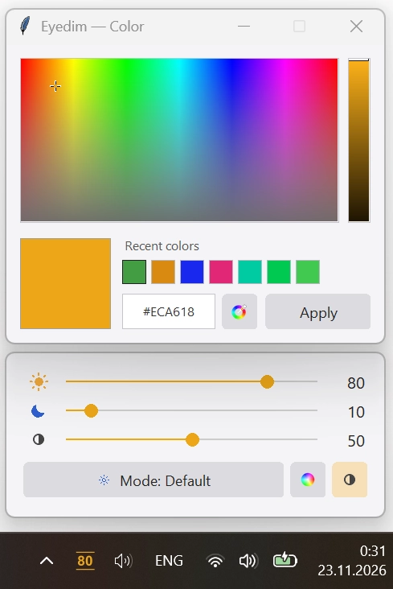

# Eyedim

Small Windows utility to control display **brightness**, **night light**, **contrast**, and **accent color** from the system tray.



## Features

- Brightness control across monitors (DDC/CI + WMI, with smooth transitions and tray mouse-wheel control at 5% per notch)
- Night light (warm color temperature) and contrast adjustment via gamma ramp
- Accent color picker for sliders and the tray icon (Excel-style spectrum, luminance wheel control, HEX input/copy/paste, screen eyedropper, and recent colors history saved in `%APPDATA%\Eyedim\config.json`)
- "User" and "Default" preset modes
- Display panel & dead pixel test from the tray menu across all monitors at once (solid black, white, red, green, blue, and gray screens, three grid densities, and a test card; temporarily uses neutral gamma for accurate inspection; click/`Space`/`→` next, right-click/`←` back, `Esc` exit)
- Autostart with Windows
- English / Russian interface

## Requirements

- Windows 10 / 11
- Python 3.13+ (tested). Earlier versions may work but are not officially supported.

## Download

[](https://github.com/proyarik/eyedim/releases/latest)

Latest version: **v2.1.1** (standalone `.exe` is around ~19.5 MB because it bundles the Python runtime and required libraries).

## Installation

Install dependencies:

```bash
pip install -r requirements.txt
```

## Usage

```bash
python eyedim.pyw
```

(or `pythonw eyedim.pyw` to run without a console window)

The app starts in the system tray. Left-click the tray icon to open the settings popup, or hover over it and scroll the mouse wheel to adjust brightness.

## Building a standalone .exe

```bash
pip install pyinstaller
py -3.13 -m PyInstaller --noconsole --onefile --upx-dir=. --upx-exclude=vcruntime140.dll eyedim.pyw
```

> **Note:** The build was tested with **Python 3.13** and **[UPX 5.2.1](https://github.com/upx/upx/releases/tag/v5.2.1)**.
>
> UPX is used to compress the resulting `.exe` (around ~19.5 MB with bundled dependencies). It is **not** bundled with the project — download it separately:
>
> 1. Go to the [UPX releases page](https://github.com/upx/upx/releases).
> 2. Download `upx-5.2.1-win64.zip`.
> 3. Extract `upx.exe` into the project folder (the same directory as `eyedim.pyw`).
> 4. Run the build command above.
>
> If you don't want to use UPX at all, simply remove `--upx-dir=.` and `--upx-exclude=vcruntime140.dll`. The build will still succeed, producing a larger `.exe`.

## ⚠️ Note on antivirus

The pre-built `.exe` was compressed with UPX. Some antivirus software may falsely flag it as suspicious. If this happens, either:

- add `eyedim.exe` to your antivirus exclusions, or
- build from source using the instructions above.

The source code is fully open and available in this repository.

## License

Distributed under the terms of the **GNU General Public License v3.0**.
See the [LICENSE](LICENSE) file for details.